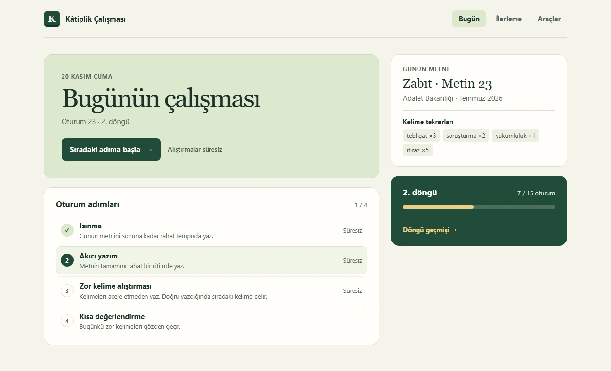
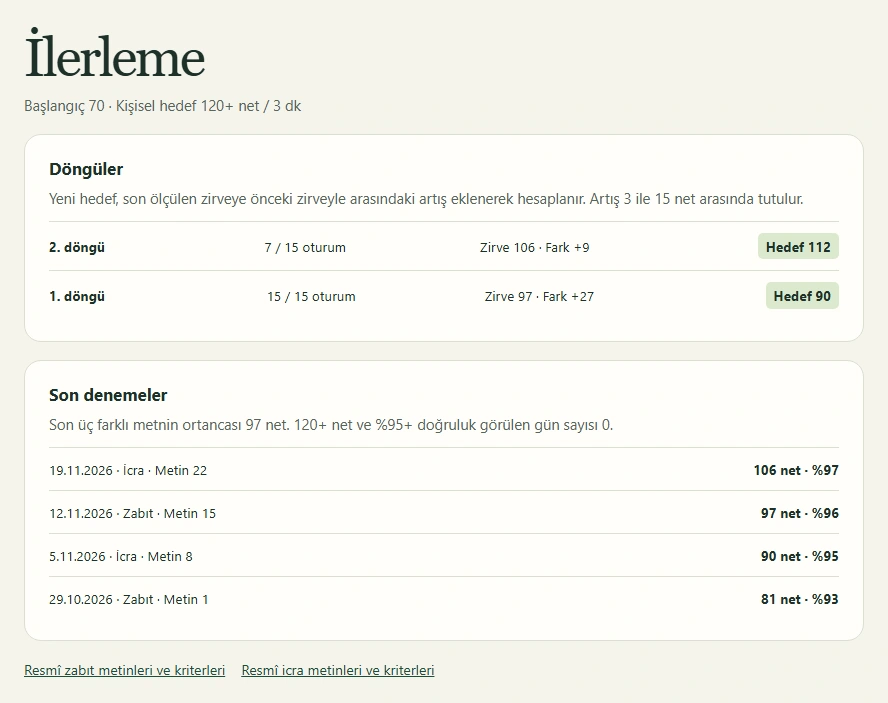

# Kâtiplik Klavye Çalışması

Zabıt ve icra kâtipliği uygulama sınavlarına hazırlanmak için tarayıcıda çalışan bir klavye uygulaması. Resmî metinlerle ısınabilir, üç dakikalık denemeler yapabilir ve sık takıldığın kelimeleri kendi hızında tekrar edebilirsin.



*Örnek bir günlük oturum.*

## Çalışma düzeni

| Oturum | Adımlar |
| --- | --- |
| Normal | Isınma → Akıcı yazım → Hatalı kelimeler → Kısa değerlendirme |
| Sınav | Isınma → Akıcı yazım → Aynı metinle 3 dk sınav → Hatalı kelimeler |

- Isınma ve akıcı yazım, metnin son kelimesine kadar süresiz devam eder.
- Normal ve sınav oturumları aynı metin sırasını kullanır. Varsayılan olarak **7 oturumda bir** sınav yapılır. İlk 30 sınavda 30 farklı metin gelir.
- Bir kelimeyi oturumda ilk kez yanlış yazdığında tekrar sayısına 5 eklenir. Sonraki oturumda toplam 1 azalır. Alıştırma aynı kelimenin arasına mümkün olduğunca farklı kelimeler koyar.
- İlerleme tarayıcıda saklanır. Ara verdiğinde kaldığın oturumdan devam edebilir, oturumu tamamlayınca aynı gün sıradaki oturuma geçebilirsin. **İlerleme** ekranında 15 oturumluk döngülerin en iyi deneme sonuçlarını görebilirsin.
- **Araçlar** bölümünde süreli ve süresiz serbest çalışma, özel metin ekleme ve Türkçe Q klavye alıştırmaları bulunur.

## İlerleme ekranı



*Örnek deneme sonuçları ve döngü hedefleri.*

## Kurulum

İlk kurulum için Git, Python ve internet bağlantısı gerekir. Metinler hazırlandıktan sonra uygulamayı doğrudan tarayıcıda açabilirsin.

```sh
git clone https://github.com/Myusufbasci/katiplik-klavye-calismasi.git
cd katiplik-klavye-calismasi
python -m pip install -r requirements.txt
python araclar/metinleri_hazirla.py
```

Ardından `index.html` dosyasını aç. Windows’ta Python’a `py` komutuyla erişiyorsan komutlardaki `python` yerine `py` kullanabilirsin.

Bakanlığın ZIP dosyası elindeyse metinleri `python araclar/metinleri_hazirla.py --arsiv "UygulamaliSinavMetinleri.zip"` komutuyla hazırlayabilirsin. Komut, tarayıcının okuyacağı `official-texts.js` dosyasını proje klasöründe oluşturur.

## Metinler ve puanlama

Temmuz 2026 zabıt ve icra duyurularının ikisinde de 30 metin var. Aynı numaralı metinler iki sette de aynı içeriği taşıyor. Kurulum komutu Bakanlığın arşivini indirir, PDF’lerden metinleri çıkarır ve iki sınav grubu için ortak havuzu hazırlar.

- [Zabıt kâtipliği metinleri ve değerlendirme kriterleri](https://pgm.adalet.gov.tr/Home/SayfaDetay/sozlesmeli-zabit-katibi-uygulamali-sinav-metinleri-ve-degerlendirme-kriterleri13072026120135)
- [İcra kâtipliği metinleri ve değerlendirme kriterleri](https://iidb.adalet.gov.tr/Home/SayfaDetay/sozlesmeli-icra-k-tipligi-uygulamali-sinav-metinleri-ve-degerlendirme-kriterleri14072026104802)

Uygulamadaki deneme puanı, yayımlanan kriterlere göre hesaplanan bir çalışma sonucudur. Birden fazla hata türü birleştiğinde Bakanlığın sınav yazılımı farklı sonuç verebilir.
